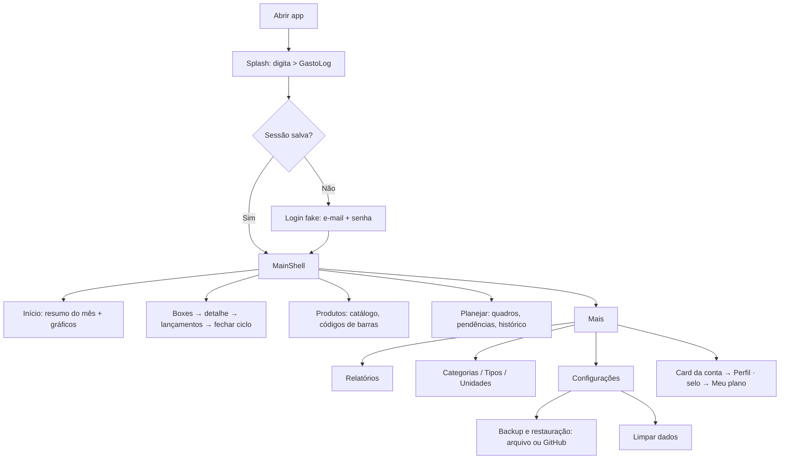

# Fluxos dos módulos

[Índice](../README.md) · [Configurações](../configuracoes/README.md)

| Módulo | Fluxo interno | Dados atuais |
|---|---|---|
| [Autenticação e perfil](autenticacao.md) | splash → login → app; perfil; sair | login fake, sessão no Hive |
| [Início](inicio.md) | resumo do mês + gráficos com filtros | só lançamentos fechados + Planejamento |
| [Boxes e lançamentos](boxes-e-lancamentos.md) | lista → detalhe → adicionar itens (produtos, avulso ou câmera) → resumo → confirmar | Hive |
| [Fechamento de ciclo](fechamento.md) | data de referência → confirmar → congela e repete no próximo ciclo | Hive, tudo ou nada |
| [Leitura de código de barras](leitura-de-codigo.md) | câmera em modo carrinho; etiqueta de balança; código desconhecido | local, sem internet |
| [Produtos e catálogos](catalogos.md) | produtos, categorias, tipos e unidades | Hive; padrões semeados na 1ª execução |
| [Planejamento](planejamento.md) | quadros kanban → comprar → finalizar/cancelar → pendências/histórico | Hive |
| [Relatórios](relatorios.md) | filtros → indicadores → comparação A×B → exportar | só lançamentos fechados + Planejamento |
| [Backup e restauração](backup.md) | ler → comparar → conferir → agir; arquivo ou GitHub | JSON; nuvem real (API do GitHub) |
| [Planos](planos.md) | Meu plano → planos → montador → cupom → pagamento simulado | Hive, pagamento simulado |
| [Configurações](configuracoes.md) | tema, idioma, sobre, limpar dados | `app_meta` |

Ao mudar uma operação, confira também [planos e limites](../configuracoes/planos-e-limites.md),
[armazenamento](../configuracoes/armazenamento.md) e [componentes](../componentes/README.md).

## Distinções do estado atual

- **Login é fake:** não há servidor nem conferência de senha; qualquer e-mail válido e
  senha com 4+ caracteres entra. Ver [Autenticação](autenticacao.md).
- **Dados não são separados por usuário.** Boxes, produtos, lançamentos e planejamento
  ficam nas mesmas Hive boxes para qualquer conta que entrar no aparelho. Só a
  **assinatura** e os **cupons usados** são guardados por usuário.
- **Pagamento é simulado:** nada é cobrado (`FakeBillingGateway`). Ver [Planos](planos.md).
- **Balanço considera só o que foi fechado.** Início e Relatórios ignoram lançamentos
  abertos; o cabeçalho da Box mostra o ciclo aberto.
- **Exportação CSV e "Backup em JSON" do relatório** aparecem no menu mas devolvem
  "em breve" (`NotImplementedFailure`). O backup completo fica em Configurações.
- **Sincronização** aparece em Mais como "Em breve"; os campos `SyncableFields` já existem
  nas entidades, mas não há transporte.
- **Módulos "Em breve" nos planos** (`available: false`): histórico de preços, metas,
  backup automático e sincronização. Estão no catálogo de planos, não no app.
- Comentários no código que citam `docs/MONETIZATION.md` apontam para um documento
  que foi removido; a regra vigente está em [Planos e limites](../configuracoes/planos-e-limites.md).
